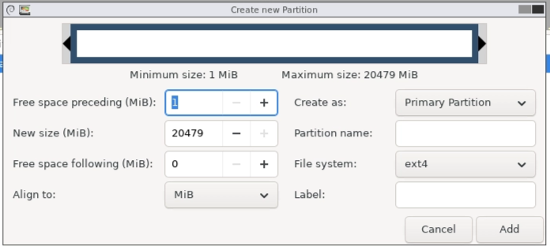
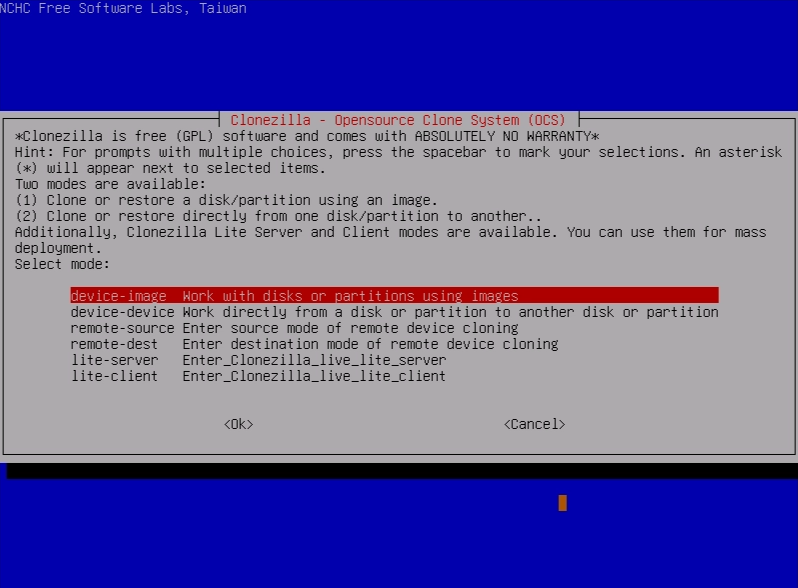
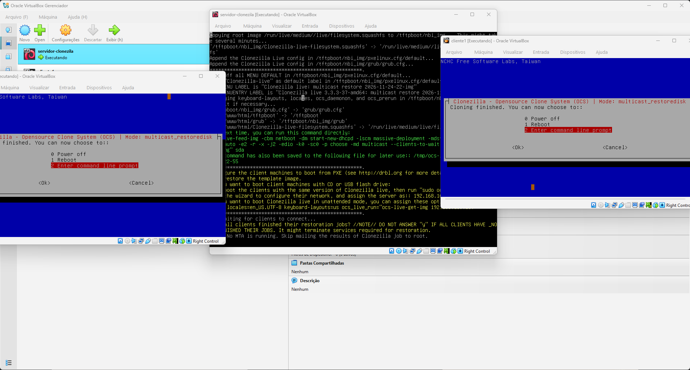

# POP-01: Clonagem de Estações em Rede via Clonezilla Lite Server/Client

| Identificação | Registro |
| --- | --- |
| Instituição e curso | Senac Minas Gerais · Técnico em Informática |
| Unidade curricular | UC 3 — Planejar e executar a manutenção de computadores |
| Atividade e autoria | Tarefa 06 · Helvecio Resende Chaves |
| Procedimento de origem | POP-BACKUP-001, v1.0 · Tarefa 05 |
| Datas do registro | Execução indicada no cabeçalho original em 11/11/2026. Captura de encerramento em 24/11/2026, às 20:00:38, conforme o nome do arquivo original. |

## 1. Objetivo e Escopo

Implantar a mesma imagem de disco em duas estações do setor administrativo por meio do **Clonezilla Lite Server/Client**. O laboratório reproduz esse cenário com três máquinas virtuais no VirtualBox. O servidor captura o disco de origem uma vez, armazena a imagem em um segundo disco e a distribui por multicast aos dois clientes. Cada cliente inicia pela rede e grava a imagem em seu próprio disco.

O procedimento termina com a conferência da restauração e os testes de aceitação em cada estação. A seção 4 registra até onde a execução foi comprovada.

## 2. Requisitos e Topologia do Ambiente

| Recurso | Servidor-Clonezilla | Cliente-01 | Cliente-02 |
| --- | --- | --- | --- |
| Processamento e memória | 2 vCPUs e 2.048 MB | 1 vCPU e 1.024 MB | 1 vCPU e 1.024 MB |
| Discos virtuais | 2 VDIs de 20 GB cada | 1 VDI de 20 GB | 1 VDI de 20 GB |
| Adaptador 1 | Intel PRO/1000 | Intel PRO/1000 | Intel PRO/1000 |
| Inicialização para a atividade | Leitor óptico com ISO GParted Live no preparo e Clonezilla Live no backup e na distribuição | Rede (PXE) em primeiro lugar, leitor óptico vazio | Rede (PXE) em primeiro lugar, leitor óptico vazio |
| Função | Repositório da imagem, DHCP e arquivos de boot via TFTP | Restaurar a imagem em disco local | Restaurar a imagem em disco local |

| Parâmetro de rede | Configuração utilizada |
| --- | --- |
| Segmento e interface | VirtualBox → Adaptador 1 → Rede Interna `clone`, com **Cabo conectado** nas três VMs. Interface do roteiro no servidor: `eth0`. |
| IP do Lite Server | Endereço completo não registrado. |
| Máscara de sub-rede | Não registrada. |
| Faixa DHCP temporária | Limites não registrados. O Lite Server fornece DHCP na rede isolada. |
| Modo de transmissão | `multicast`, com `clients-to-wait` = `2`. |
| Boot e Secure Boot | PXE como primeira opção nos clientes. Estado do Secure Boot não registrado. |

Antes de iniciar, confira que o segmento está isolado de outros servidores DHCP e que cada disco de destino tem capacidade igual ou superior à do disco de origem. Se o firmware bloquear o carregamento PXE, verifique a compatibilidade com Secure Boot e ajuste-o somente se o ambiente exigir.

**Mapa dos discos.** Os nomes abaixo valem dentro da VM indicada. Confira a controladora, a porta e a capacidade antes de confirmar uma operação.

| VM e dispositivo | Papel |
| --- | --- |
| Servidor · disco A, `/dev/sda` | Origem da captura de disco inteiro com `savedisk`. |
| Servidor · disco B, `/dev/sdb1` | Partição do repositório, montada em `/home/partimag`. Guarda a imagem `2026-11-24-22-img`. |
| Cada cliente · `/dev/sda` | Disco de destino que será sobrescrito por `restoredisk`. |

## 3. Passo a Passo Operacional

### 3.1. Configuração do Servidor (`lite-server`)

#### Preparar os discos e salvar a imagem

Se a imagem já estiver disponível no disco B, prossiga para **Distribuir a imagem por multicast**.

**Antes de particionar:** criar uma tabela de partições apaga a estrutura existente. Se o disco A já contém o sistema a distribuir, preserve-o. Se o disco B já guarda imagens, preserve também o repositório.

1. **Preparar os VDIs vazios do laboratório.** Inicie o servidor pela ISO do GParted Live. Escolha `GParted Live (Default settings)`, mantenha o teclado e abra o ambiente gráfico. Para cada VDI vazio da atividade, confira o dispositivo, escolha **Device → Create Partition Table → gpt** e depois **Partition → New → ext4 → Add**. Revise a fila e confirme em **Apply**. O resultado previsto é uma partição em cada disco, `/dev/sda1` e `/dev/sdb1`.
2. **Conferir o conteúdo da matriz.** Para gerar uma imagem inicializável, o sistema e os aplicativos devem estar instalados e testados antes da captura. Um disco apenas formatado produzirá uma cópia dessa estrutura vazia.
3. **Abrir o assistente de backup.** Troque a ISO por Clonezilla Live, selecione `English`, mantenha o teclado com `Keep` e abra `Start_Clonezilla`. Selecione `device-image` e depois `local_dev`.
4. **Montar o repositório.** Aguarde a detecção de `sda` e `sdb`. Use `Ctrl+C` para sair da varredura depois que ambos aparecerem. Selecione a partição `sdb1` e a raiz `/` dela. Confirme que `/dev/sdb1` está montada em `/home/partimag` e que há espaço para a imagem.
5. **Capturar o disco A.** Em `Beginner → savedisk`, informe o nome da imagem e escolha `sda` como origem. O nome mostrado na sessão documentada é `2026-11-24-22-img`. Mantenha a compressão padrão, selecione a verificação da imagem salva e revise o resumo antes de confirmar. Aguarde o resultado e desligue o servidor mantendo o disco B associado.

*Figura 1. A janela New permite conferir o tamanho e o sistema de arquivos antes de adicionar a operação à fila.*

*Figura 2. No backup local, device-image salva o conteúdo de um disco como imagem no repositório. O modo lite-server aparece no mesmo menu para a etapa de distribuição.*

Capturas complementares do preparo dos discos e do backup local

| Etapa | Capturas do material da Tarefa 05 | O que conferir |
| --- | --- | --- |
| Abrir o GParted | [Menu inicial](img/gparted-inicializacao.png) · [Mapa do teclado](img/gparted-teclado.png) | Iniciar pelas opções padrão. |
| Identificar a unidade | [Área de trabalho](img/gparted-espaco-livre.png) · [Seletor de disco](img/gparted-seletor-disco.png) | A captura ilustra um disco NVMe. Identifique os VDIs da sua VM pela controladora e pela porta. |
| Preparar e revisar | [Menus Device e Partition](img/gparted-menus.png) · [Fila de operações](img/gparted-fila.png) · [Resultado](img/gparted-conclusao.png) | A imagem da fila ilustra uma exclusão pendente. Para o preparo descrito acima, confirme somente as operações previstas para o VDI vazio. |
| Abrir o Clonezilla | [Idioma](img/clonezilla-idioma.png) · [Teclado](img/clonezilla-teclado.png) · [Start_Clonezilla](img/clonezilla-iniciar.png) | Selecionar o idioma, manter o teclado e iniciar o assistente. |
| Localizar o repositório | [Seleção de local_dev](img/clonezilla-repositorio.png) · [Aviso de detecção](img/clonezilla-deteccao.png) · [Varredura de discos](img/clonezilla-discos.png) | A varredura ilustrativa mostra apenas `sda`. No laboratório, aguarde também o disco B antes de avançar. |

#### Distribuir a imagem por multicast

1. **Iniciar a sessão.** No servidor, inicie pela ISO do Clonezilla Live. Escolha `Start_Clonezilla → lite-server` e a opção de iniciar um novo servidor (`start` no POP de origem, `start-new-lite-server` no enunciado).
2. **Ativar o boot em rede.** Selecione `netboot` e confirme a interface ligada à rede interna `clone`. Configure o endereço estático e a máscara do servidor conforme o plano do laboratório. Inicie o DHCP integrado (`start-new-dhcpd`) e confira a faixa oferecida aos clientes. Em uma nova execução, registre os três valores na tabela da seção 2.
3. **Selecionar a imagem.** Escolha o repositório local (`local_dev`), monte novamente `/dev/sdb1` em `/home/partimag` e selecione `Beginner → massive-deployment → from-image → restoredisk`. Escolha `2026-11-24-22-img`.
4. **Revisar os destinos.** Selecione `sda` como disco de destino **dos clientes**. Para os VDIs de mesmo tamanho, mantenha a tabela de partições da imagem. A restauração sobrescreve os dois destinos. Antes de confirmar, confira a imagem, o disco selecionado e as duas VMs conectadas ao segmento.
5. **Definir o disparo e entrar em espera.** Para a ação final, selecione `choose`. Em transmissão, escolha `multicast → clients-to-wait → 2`. Revise o resumo e confirme. Deixe o servidor no aviso de espera com DHCP e o serviço de boot ativos enquanto os clientes ingressam na sessão.

### 3.2. Inicialização dos Clientes (`lite-client`)

1. Com as VMs desligadas, abra **Configurações → Sistema → Placa-mãe** no VirtualBox. Em cada cliente, coloque **Rede** em primeiro lugar, deixe o leitor óptico vazio e confira o Adaptador 1 na rede interna `clone`.
2. Com o Lite Server em espera, ligue os dois clientes. Em cada console, acompanhe a obtenção do endereço por DHCP e o carregamento inicial pelo TFTP. Se surgir o menu PXE, deixe iniciar a entrada de restauração multicast da imagem selecionada. Neste laboratório os clientes recebem o perfil pela rede. A seleção manual de `lite-client` se aplica à inicialização por mídia própria.
3. Confira no servidor a entrada das duas estações. Ao atingir `clients-to-wait = 2`, acompanhe a gravação em `/dev/sda` nos dois clientes. Mantenha a sessão ativa até que ambos cheguem ao menu final.
4. Registre as telas. Como a ação definida foi `choose`, selecione **Power off** em cada cliente após a conclusão. Encerre os serviços no servidor somente depois de conferir os dois resultados. Para os testes funcionais, altere a prioridade de boot dos clientes para **Disco rígido**.

## 4. Checklist de Homologação e Pós-Clonagem

*Figura 3. Captura do POP da Tarefa 05, registrada em 24/11/2026 às 20:00:38, conforme o nome do arquivo original. À direita, a VM cliente1 exibe “Cloning finished”. À esquerda, o segundo cliente mostra o final da mensagem e as opções de encerramento. O console central identifica a imagem distribuída.*

**Resultado documentado.** Os dois clientes chegaram ao menu final de restauração. O horário inicial e a duração total da transferência não foram registrados. A captura confirma o fim da gravação. A liberação das estações depende dos testes abaixo.

- [x] **Restauração nos dois clientes.** Ambos atingiram o menu final da sessão multicast.
- [ ] **Boot local.** Em cada cliente, iniciar pelo VDI restaurado e verificar se o sistema chega à tela de login sem erros de boot ou partição.
- [ ] **Drivers e rede.** Conferir dispositivos e adaptador de rede no sistema restaurado. Verificar se cada cliente obtém o endereço esperado e alcança um equipamento conhecido da rede de teste.
- [ ] **Integridade dos dados e aplicativos.** Abrir um aplicativo previsto na matriz e comparar um arquivo de teste com o da origem, usando seu conteúdo ou uma soma de verificação.
- [ ] **Hostname.** Atribuir um nome exclusivo ao sistema de cada estação e conferir os dois após reiniciar. Os nomes das janelas do VirtualBox identificam as VMs.
- [ ] **Identidade do sistema.** Conforme o SO, verificar a individualização do Machine-ID no Linux ou a preparação da imagem Windows com Sysprep e a verificação de identidade prevista pela equipe.
- [ ] **Licenciamento e sigilo.** Conferir com o responsável se as licenças do sistema e dos aplicativos cobrem as duas instalações. Registrar a autorização de uso da imagem e conferir as permissões de acesso ao repositório e às evidências, conforme as regras da instituição, a Lei do Software e a LGPD.

Os itens em aberto aguardam evidência nas duas estações. Para cada teste, registrar o cliente, a data, o resultado e a identificação do responsável antes de liberar o equipamento.

## 5. Registro de Incidentes e Troubleshooting

O POP de origem lista falhas potenciais. A execução documentada não tem registro de incidente com correção aplicada. Use o quadro para diagnosticar uma ocorrência e registrar a medida que resolveu o problema.

| Sintoma | Causa provável | Diagnóstico e ação corretiva |
| --- | --- | --- |
| Cliente não recebe IP no boot PXE | Rede interna divergente, cabo virtual desconectado, DHCP inativo ou outro DHCP no segmento | Conferir o nome `clone`, o Adaptador 1 e **Cabo conectado** nas três VMs. Confirmar PXE em primeiro lugar e o DHCP do Lite Server em escuta na rede isolada. Repetir o boot do cliente. |
| Cliente recebe IP, mas o TFTP trava | Interrupção do carregamento inicial ou serviço TFTP inacessível | Verificar rede e TFTP. Se a gravação ainda não começou, manter o servidor em escuta e reiniciar somente o cliente afetado. |
| Servidor em espera e multicast não inicia | Apenas um cliente chegou à sessão | Manter a contagem em `2`. Identificar a estação ausente e conferir seu boot PXE até que ambas estejam prontas. |
| Imagem não aparece em `restoredisk` | Partição ou diretório de repositório incorreto | Remontar `/dev/sdb1` em `/home/partimag`, selecionar o diretório usado no backup e conferir o nome da imagem. |
| Falha no particionamento do destino | Capacidade insuficiente, tabela inconsistente ou falha de leitura/gravação no VDI | Identificar o VDI afetado e conferir sua capacidade e integridade. Corrigir ou substituir o destino antes de repetir a restauração. Preservar o disco B que contém o backup. |
