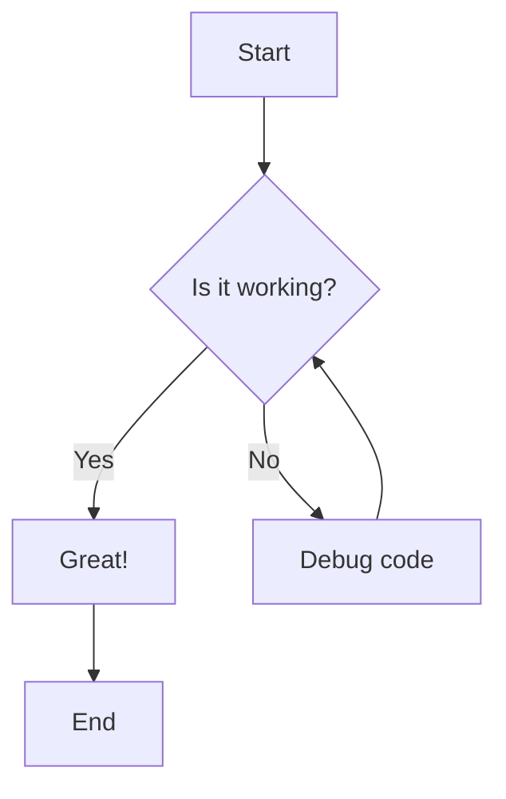

# Olá, eu sou o SENAC!

Bem-vindo ao meu primeiro repositório no **GitHub**.

## O que estou aprendendo hoje:

- Criar e organizar arquivos em **Markdown** (`.md`)
- Versionar alterações usando o **Git** no VS Code
- Sincronizar projetos locais com a nuvem

## Ferramentas instaladas no laboratório:

1. Git
1. Git Bash
1. Visual Studio Code




```code
    adjsajfnjdnfvjdnvjncvncjnvjc
```
